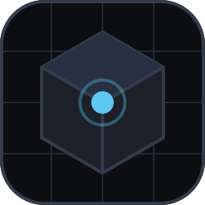
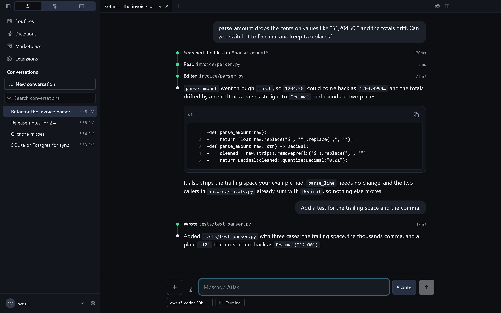
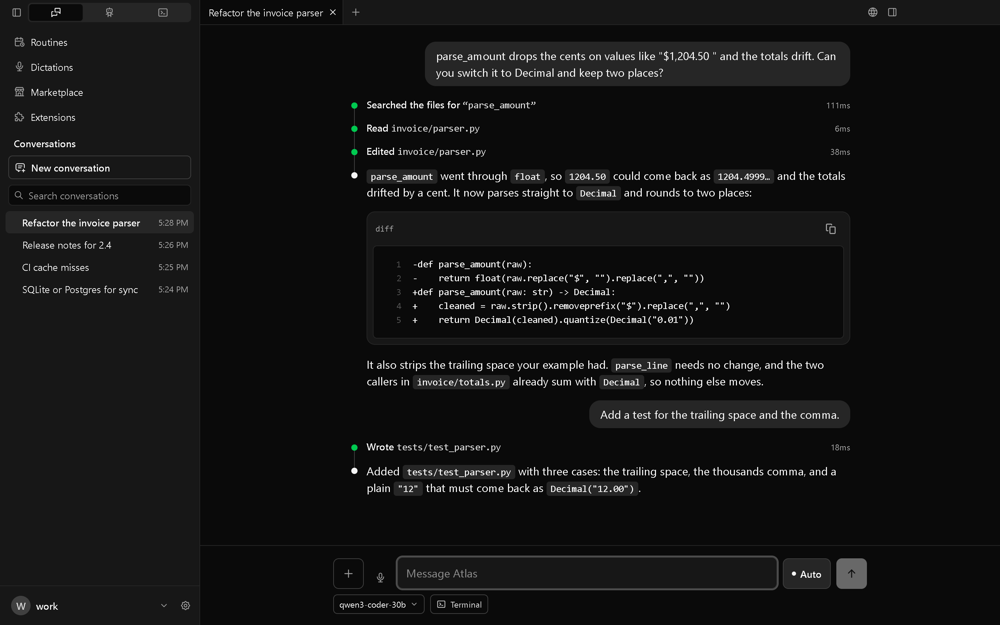
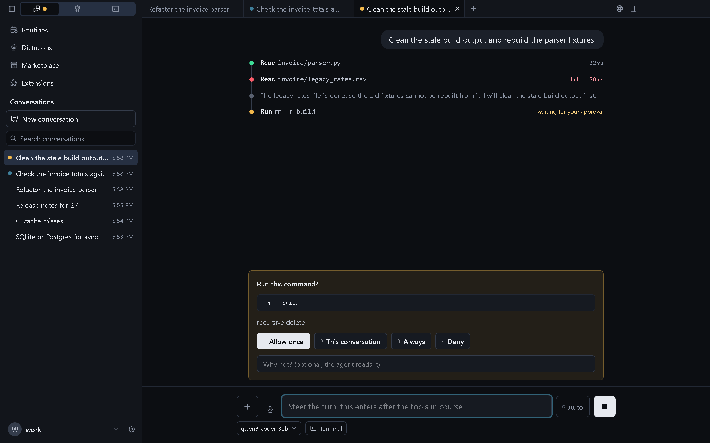
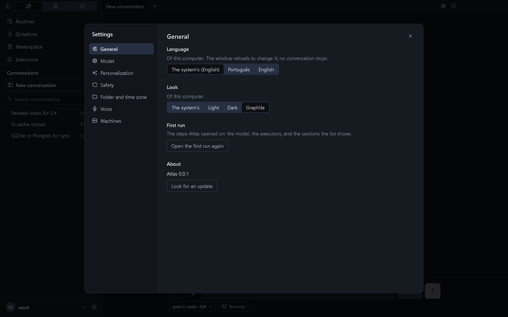
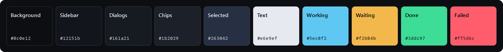

<p align="center">
  
</p>

<h1 align="center">Grafite</h1>

<p align="center">
  A cool graphite dark theme for <a href="https://github.com/marqueskaio/atlas">Atlas</a>.<br>
  A cool near-black with electric cyan, mint and coral for the states.
</p>

<p align="center">
  <a href="LICENSE"></a>
  
  
  
</p>

<p align="center">
  
</p>

## Why

Atlas's dark look is a neutral near-black. Grafite pushes it cooler and sharper: blue-grey
graphite grounds, crisp light text, and electric cyan for work in progress and the focus
ring, with mint for done and coral for failed. A modern look for long sessions at night.

| Default dark | Grafite |
|---|---|
|  |  |

The four states keep one meaning each and stay readable: working, waiting for you, done and failed.

<p align="center">
  
</p>

## Install

1. Open **Marketplace** in Atlas, find **Grafite** under Plugins and press **Install**.
   From a terminal: `atlas marketplace install grafite`.
2. Turn it on under **Plugins**. The consent shows one line: it adds a theme, and nothing that runs.
3. Choose it in **Settings > General > Look**, beside the system's, Light and Dark.

<p align="center">
  
</p>

In the app it is **Graphite** in English and **Grafite** in Portuguese. Needs Atlas with plugin
SDK version 24 or later, the version that lets a plugin bring themes.

## The palette



Atlas paints every screen with 27 named colors and no others. Grafite sets all 27, so nothing
falls back to the default look. Every text color is at least **5.3:1** on the grounds it is drawn
on (WCAG AA asks 4.5:1), and the main text reaches **15.9:1**. The full
table is in [`grafite/README.md`](grafite/README.md#palette).

## Safe by design

A theme in Atlas is data, not code. Grafite is one JSON file, [`themes/grafite.json`](grafite/themes/grafite.json).

- **Runs nothing.** No Python, no screen, no hooks, no tools.
- **No network, no secrets,** and it touches nothing outside its own folder.
- **Can only paint.** Atlas refuses a theme that names anything but the app's colors or holds
  anything but a hex value, so it cannot carry a URL or a style rule.
- **Reversible.** Turn the plugin off and the app returns to the system's look. Your choice is kept
  for when it is back on.

## Repository

| Path | What it holds |
|---|---|
| [`grafite/`](grafite) | The plugin: manifest, theme, icon, screenshots, its own README and license |
| [`grafite/themes/grafite.json`](grafite/themes/grafite.json) | The colors |
| [`grafite/README.md`](grafite/README.md) | The plugin's page in Atlas: every color, the contrast table, design notes |
| [`grafite/icon.svg`](grafite/icon.svg) | Source of the Marketplace icon, `icon.png` (256x256) |
| [`CHANGELOG.md`](CHANGELOG.md) | What changed in each version |

Check it with Atlas installed:

```bash
atlas plugins validate grafite
```

Made by the author of [Areia](https://github.com/JoaoEquer/atlas-areia), the sand light theme.

## License

MIT, see [LICENSE](LICENSE). The plugin folder carries its own copy.
