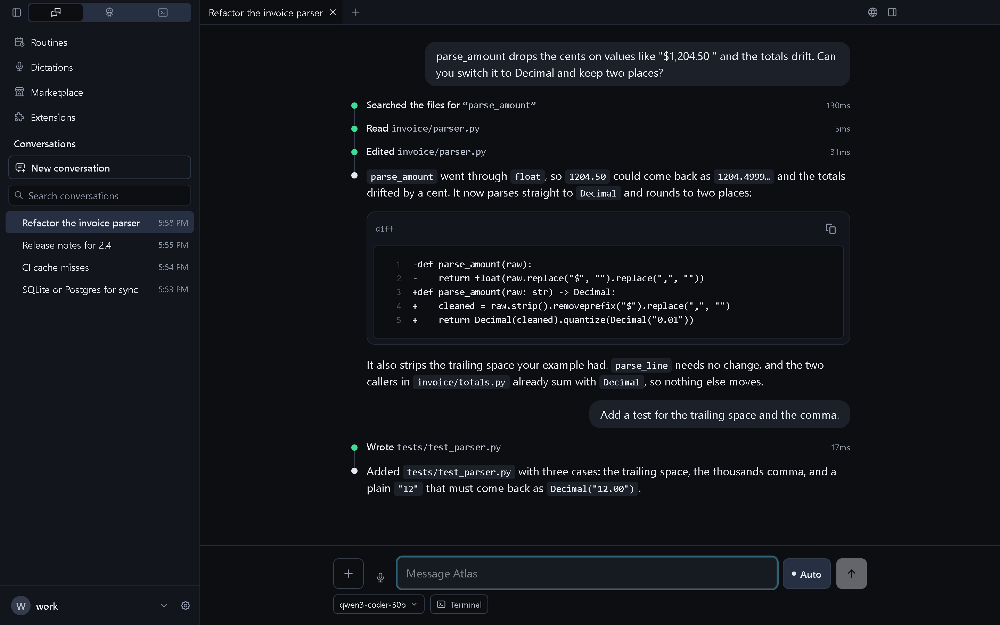
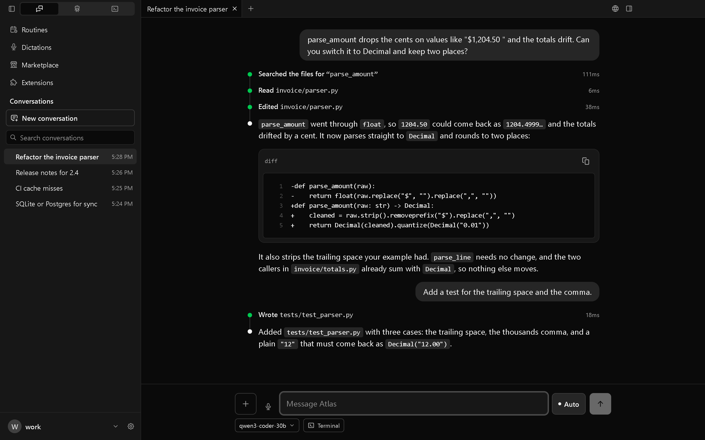
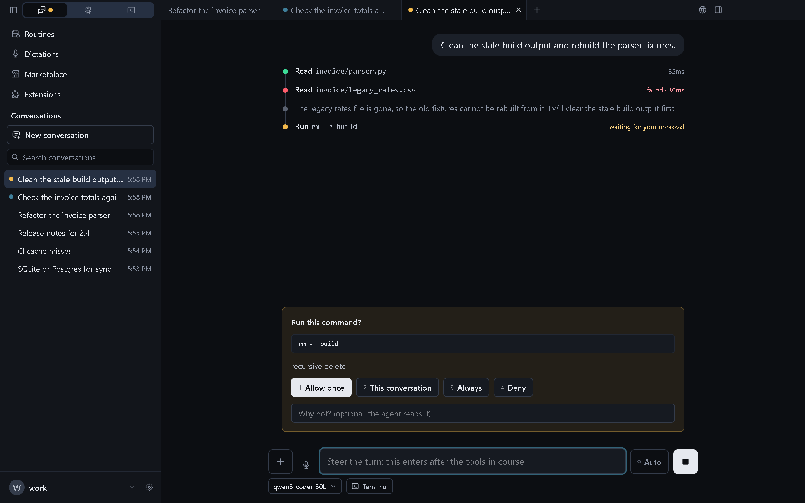
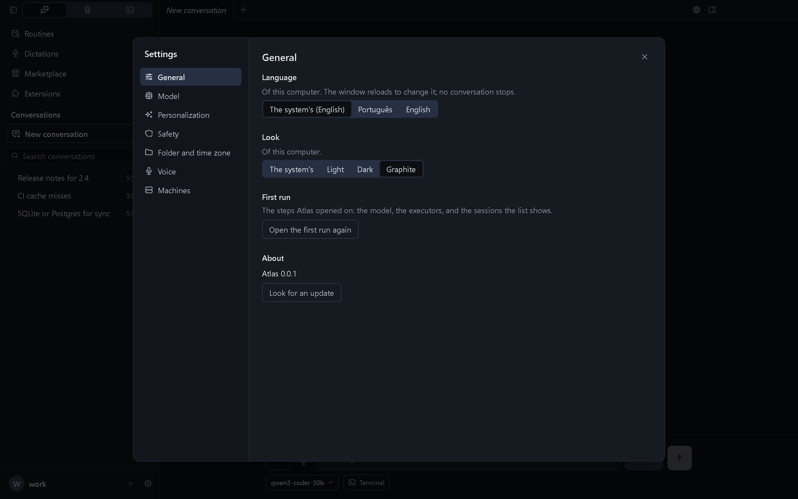
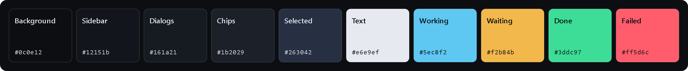

# Grafite

A cool graphite dark theme for Atlas: a cool near-black with electric cyan, mint and coral for the states.



In the app's settings it is called **Graphite** in English and **Grafite** in Portuguese.

## Before and after

The same conversation in Atlas's default dark look and in Grafite. The layout does not move;
only the colors change.

| Atlas, dark (default) | Atlas, Grafite |
|---|---|
|  |  |

The four states keep one meaning each and stay readable on the dark: working, waiting for you,
done and failed.



## What it changes, and what it doesn't

**Changes**

- All 27 named colors Atlas paints with: grounds, text, lines, focus ring, actions, states, and
  added and removed lines.

**Doesn't change**

- Layout, fonts, sizes or spacing.
- Native form controls and scrollbars: the theme sits on `dark`, so they keep their dark variants.
- Your files, settings or other plugins: it only adds a choice to **Look**.

## Install

1. Open **Marketplace** in Atlas, find **Grafite** under Plugins and press **Install**.
2. Turn it on under **Plugins**. The consent shows one line: it adds a theme, and nothing that runs.
3. Choose **Graphite** in **Settings > General > Look**, beside the system's, Light and Dark.



From a terminal, steps 1 and 2 are:

```bash
atlas marketplace install grafite
atlas plugins enable grafite
```

Needs Atlas with plugin SDK version 24 (`atlas.api` 24) or later, the version that lets a plugin
bring themes.

## Safety

It brings one file, [`themes/grafite.json`](themes/grafite.json): a hex color for every one of the
app's named colors, on top of the app's dark look. Nothing else.

- **It runs no code.** No Python, no screen, no hooks, no tools, no scripts.
- **It reaches no network** and reads no secret.
- **It touches nothing outside its own folder.**
- **It cannot paint anything but the app's named colors.** Atlas refuses a theme that names any
  other variable or holds anything that is not a hex color, so a theme is data and cannot carry a
  URL or a style rule.

If you turn the plugin off, the app goes back to the system's look and keeps your choice for when
the plugin is on again.

## Palette



Atlas paints every screen with 27 named colors and no others; this theme sets each of them, so
nothing falls back to the default dark look.

**Grounds**

| Name | Color |
|---|---|
| `background` | `#0c0e12` |
| `subtle` | `#12151b` |
| `raised` | `#161a21` |
| `muted` | `#1b2029` |
| `hover` | `#1f2530` |
| `selected` | `#263042` |
| `scrim` | `#000000a6` |

**Text**

| Name | Color |
|---|---|
| `foreground` | `#e6e9ef` |
| `soft` | `#b7bdc9` |
| `muted-foreground` | `#8b93a3` |
| `faint` | `#5a6170` |

**Lines and focus**

| Name | Color |
|---|---|
| `border` | `#222834` |
| `border-strong` | `#343c4b` |
| `ring` | `#5ec8f2` |

**Actions**

| Name | Color |
|---|---|
| `primary` | `#e6e9ef` |
| `primary-foreground` | `#0c0e12` |

**States**

| Name | Color |
|---|---|
| `working` | `#5ec8f2` |
| `waiting` | `#f2b84b` |
| `waiting-text` | `#f7cf7f` |
| `waiting-foreground` | `#2b1f05` |
| `done` | `#3ddc97` |
| `done-text` | `#7be8b9` |
| `failed` | `#ff5d6c` |
| `failed-text` | `#ff98a2` |
| `danger` | `#ff5d6c` |
| `added` | `#3ddc97` |
| `removed` | `#ff5d6c` |

### Contrast

Every text color is at least 4.5:1 (WCAG AA) on the four grounds a screen draws text on. The ratios
below were computed from the hex values with the WCAG relative-luminance formula; `foreground` on
`background` reaches 15.9:1.

| Text color | on `background` | on `subtle` | on `raised` | on `muted` |
|---|---|---|---|---|
| `foreground` `#e6e9ef` | 15.9 | 15.0 | 14.3 | 13.4 |
| `soft` `#b7bdc9` | 10.2 | 9.7 | 9.3 | 8.7 |
| `muted-foreground` `#8b93a3` | 6.3 | 5.9 | 5.6 | 5.3 |
| `working` `#5ec8f2` | 10.1 | 9.6 | 9.2 | 8.6 |
| `waiting-text` `#f7cf7f` | 13.0 | 12.3 | 11.8 | 11.0 |
| `done-text` `#7be8b9` | 13.0 | 12.3 | 11.7 | 11.0 |
| `failed-text` `#ff98a2` | 9.4 | 8.9 | 8.5 | 8.0 |

`faint` only decorates (a chevron, a dot at rest, a word that cannot be used, as Atlas defines it)
and is 3.1:1 on `background` on purpose. `ring`, the keyboard's place, is
10.1:1. `border` and `border-strong` are edges, not text, at
1.3:1 and 1.7:1.

## Design

- **Cool neutrals.** Every ground leans blue-grey: `background` is `#0c0e12`, the sidebar a
  step lighter, and dialogs and fields another step (`raised`), so depth reads as stacked
  sheets of graphite.
- **One accent.** Electric cyan (`#5ec8f2`) marks what is working and where the keyboard is;
  nothing else on screen competes with it.
- **States stay legible.** Cyan, amber, mint and coral keep one meaning each; their `-text`
  variants are lifted until they read as words on the dark.

## Develop

```bash
atlas plugins validate grafite     # loads it as Atlas does and says what is wrong
```

The folder name must equal the plugin's `name`, as Atlas requires. To try a change, copy the folder
into your home's `plugins/`, run `atlas plugins enable grafite`, and pick the theme in Settings.

## Changelog

See [CHANGELOG.md](https://github.com/JoaoEquer/atlas-grafite/blob/main/CHANGELOG.md).

## License

MIT, see [LICENSE](LICENSE).
